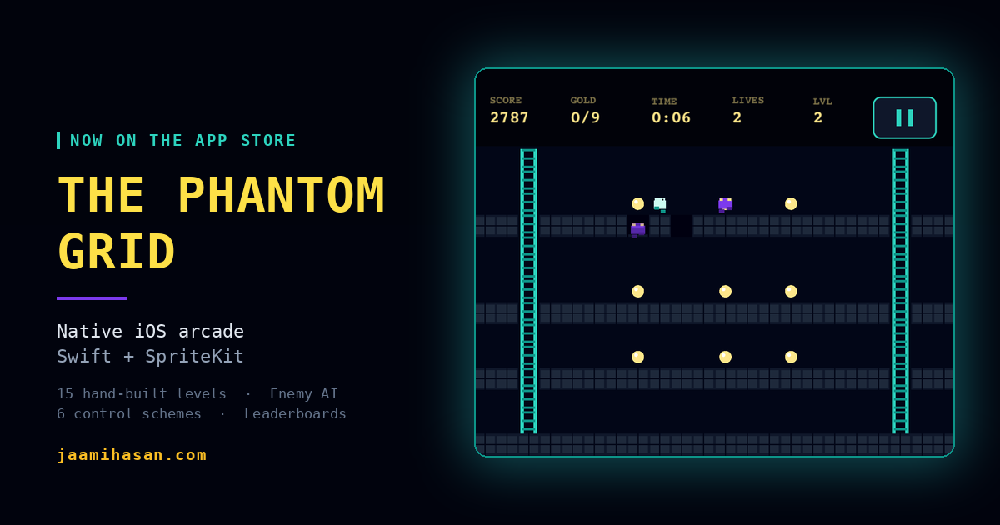
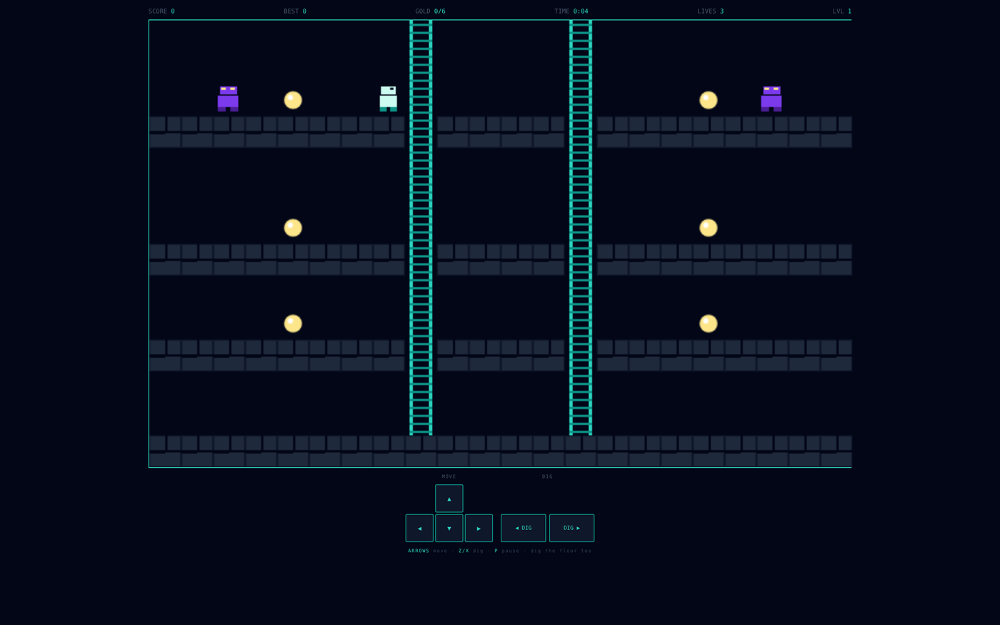
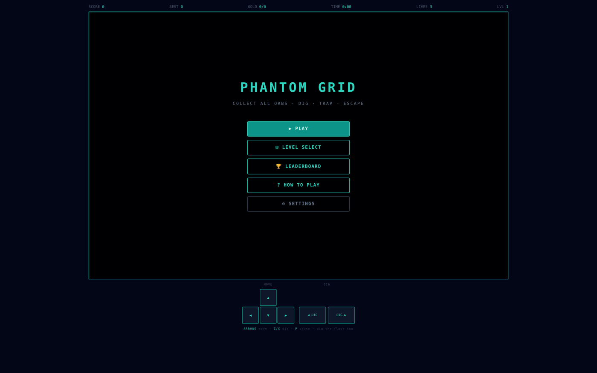

# The Phantom Grid — web port

<p align="center">
  <a href="https://apps.apple.com/app/the-phantom-grid/id6785081612"></a>
</p>

<p align="center">
  <a href="https://jaamihasan.com/game.html"><b>▶ Play in the browser</b></a> ·
  <a href="https://apps.apple.com/app/the-phantom-grid/id6785081612"><b> Native iOS version on the App Store</b></a>
</p>

The Phantom Grid is a grid-based arcade game: collect every gold orb on the level, dig holes to trap the phantoms hunting you, then find the way out. I designed, built and shipped it as a **native iOS game (Swift + SpriteKit)**, then ported the full ruleset to the browser so anyone can play it without installing anything.

This repository is that browser port — **~900 lines of dependency-free JavaScript on a `<canvas>`**, plus one stylesheet. No framework, no bundler, no build step.

| | |
|---|---|
|  |  |

## What's in the game

- **15 hand-built levels** (The Gate → The Nexus), each authored as a 22×14 tile map in a compact string format
- **Enemy AI** — phantoms alternate between *chase* and *patrol* goals, climb ladders toward the player, fall into holes, carry gold with them, and respawn; a stuck-detector and ladder-escape routine keep them from freezing in corners
- **Dig mechanics** — holes close on a timer that shortens as levels progress; a trapped phantom scores points, and digging the floor under yourself is a legitimate (risky) move
- **Per-level leaderboards** with player initials, stored locally
- **Settings** — five speed levels, three difficulty levels (which scale enemy speed and hole lifetime), ladder assist, sound toggle
- **Touch + keyboard** — on-screen D-pad and dig buttons for phones; arrows / Z / X / P on desktop
- **Procedural audio** — every sound effect is synthesized with the Web Audio API (no audio files)

## How it's built

```
index.html      HUD, menus, overlays, on-screen controls
css/style.css   layout, HUD, buttons, responsive canvas
js/game.js      everything else
```

Inside `js/game.js`:

- **Fixed-timestep loop.** `requestAnimationFrame` feeds an accumulator; the simulation steps at exactly 60 Hz regardless of display refresh rate, so physics and enemy timing are identical on a 60 Hz phone and a 120 Hz laptop.
- **Tile world.** The grid is a 2-D array of six tile types (empty, brick, bedrock, ladder, bar, gold). All movement rules reduce to a handful of predicates — `isSolid`, `isPass`, `hasSupport`, `isLad` — which makes the level format trivial to author and the collision logic easy to reason about.
- **Level format.** Each level is 14 strings of 22 digits. Adding a level means adding one array literal and a name.
- **Rendering.** The canvas keeps a fixed 616×392 logical resolution and is CSS-scaled to fit the viewport (re-fit on resize), then drawn in three passes (grid → player → enemies) with a banner layer for countdowns and level-clear.
- **Persistence.** High score, unlocked levels, initials, and settings live in `localStorage` under `pg_*` keys.

## Run it locally

No install. Open `index.html`, or serve the folder:

```bash
python3 -m http.server 8000
# → http://localhost:8000
```

## About the iOS version

The native game was built in Swift with SpriteKit and shipped through the full App Store lifecycle — TestFlight beta, certificate and provisioning setup, App Store Connect review — and is live for iPhone. An Android port in Unity 6 is in progress. The Swift source is not in this repository.

---

**Jaami Hasan** · [jaamihasan.com](https://jaamihasan.com) · [LinkedIn](https://www.linkedin.com/in/jaamihasan) · [GitHub](https://github.com/yungking304)
